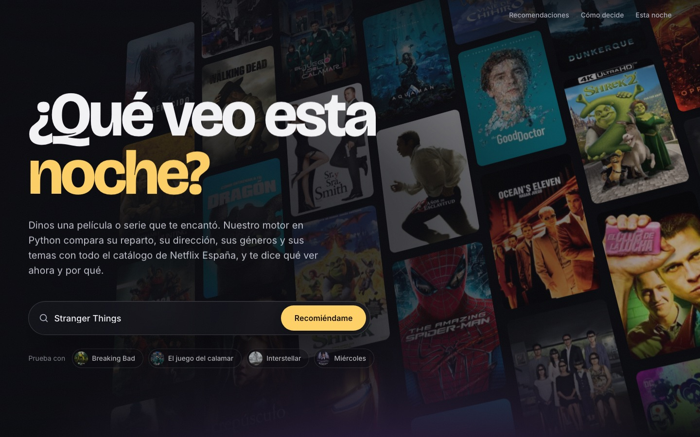
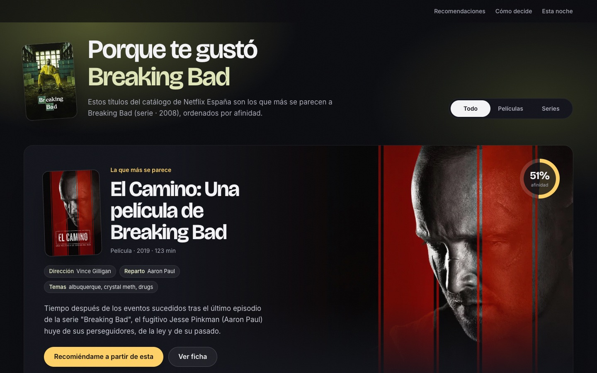
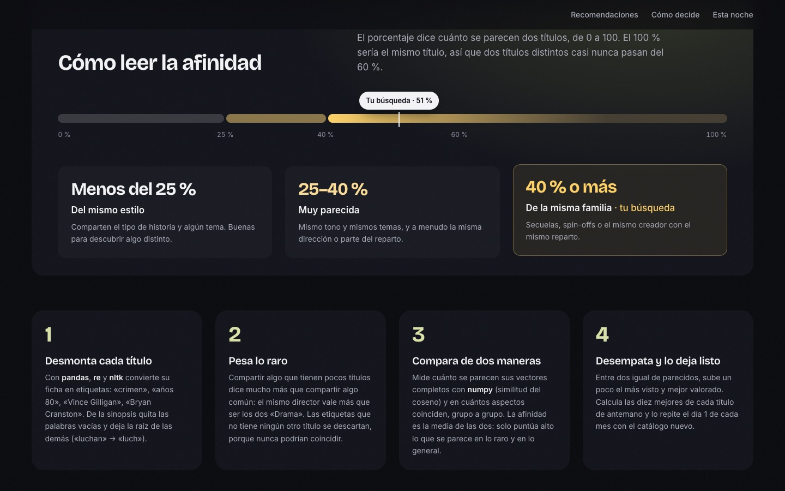
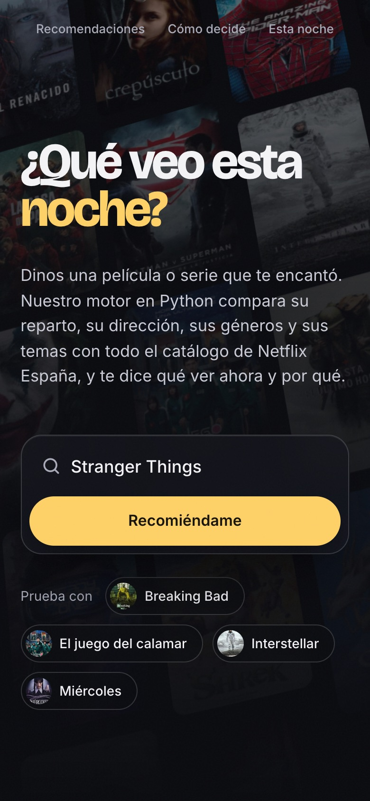
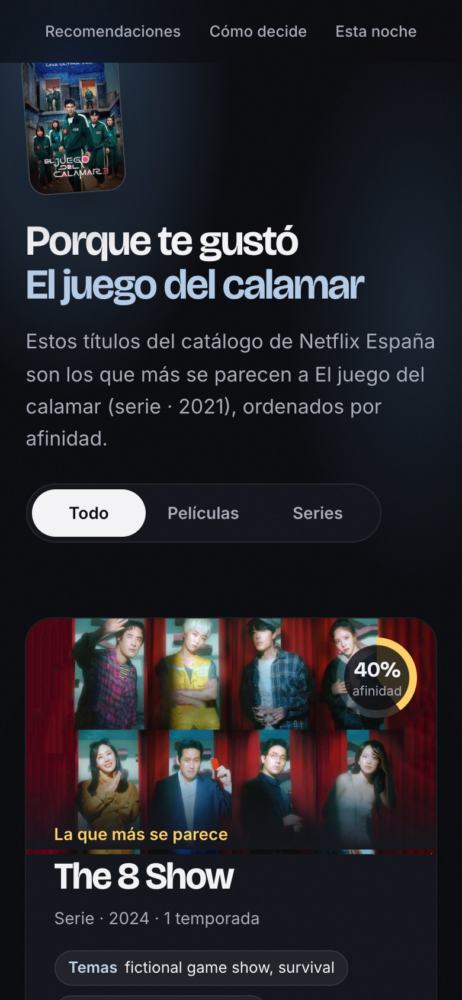
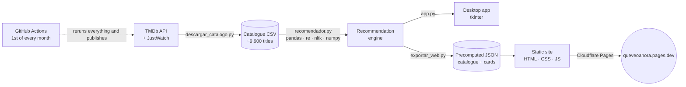

# 🍿 ¿Qué veo ahora? · A Netflix recommender built with Python

[🇪🇸 Español](README.md) · **🇬🇧 English**

**Tell it a film or series you loved, and it tells you what to watch tonight on Netflix Spain, and why.**

*«¿Qué veo ahora?» is Spanish for "What should I watch now?". The website is in Spanish.*

[](https://queveoahora.pages.dev)


👉 **Try it at https://queveoahora.pages.dev**



Portfolio project for the advanced Python module of the **Conquer Blocks Full Stack Master's**.

---

## 🎯 The problem it solves

We have all spent twenty minutes scrolling through Netflix without picking anything. This app
starts from something you already know (a film or series you liked) and searches **the real,
current Netflix Spain catalogue** (about 9,900 titles) for the ones most like it.

Every recommendation comes with:

- an **affinity percentage**, with a scale that explains what it means;
- the **concrete reasons**: same director, shared cast, shared themes or genres;
- a detail card with the synopsis, cast and rating.

It does not use other people's ratings, and there is no black box: it is a **content-based
recommender** written from scratch with `pandas`, `numpy`, `re` and `nltk`, and the website
shows live how it reached each decision.

## ✨ What you can do on the site

| | |
|---|---|
|  | **Explained recommendations.** The closest match shown large, plus ten more with their affinity and reasons. Filter by films or series, and use any result as a new search. The page's ambient light takes on the colour of the poster you pick. |
|  | **How it decides.** Lights up the groups (genres, themes, director, cast…) that your title and the top recommendation really share, and places your search on a gauge that explains how to read the percentage. |

- 🔎 **Forgiving search**: case and accents don't matter, and it understands original or English
  titles ("Money Heist" finds «La casa de papel»).
- 🌙 **"Tonight"**: drag a slider to the free time you have and it tells you how many films in the
  catalogue you can watch in full, with the five most popular fanned out.
- 🔗 **Shareable links**: `https://queveoahora.pages.dev/?t=Breaking Bad` opens that title's
  recommendations directly.
- 📱 **Designed for phones too**, usable from the keyboard and respectful of reduced-motion
  preferences.

<p align="center">
  
  &nbsp;&nbsp;
  
</p>

## 🏗️ How it is built



### ⚙️ Backend: the Python engine

**1. Real, current data.** The Netflix datasets on Kaggle stopped in 2021, so
`descargar_catalogo.py` builds its own catalogue from the TMDb API, which knows what is on
Netflix in each country thanks to JustWatch. For every title it downloads the synopsis, genres,
keywords, country, cast, director (or creators, for series), age rating and score. It runs
several requests in parallel (`concurrent.futures`) and retries on failure. When there is no
Spanish synopsis it falls back to English, and titles in other scripts (오징어 게임) are replaced
by their English title.

**2. Cleaning.** With `pandas` and `re`, each title becomes groups of tags. With `nltk`, synopses
lose their stop words and each word is reduced to its stem (`luchan` → `luch`). The language of
each synopsis is detected automatically.

**3. How rare each tag is (TF-IDF).** Sharing something rare says more than sharing something
common: the same director weighs far more than both being "Drama". Tags that only one title has
are dropped, since they can never match and would only lower all of its affinities.

**4. Weights per group.** Each tag is worth *its group's weight × rarity*:

| Group | Weight | | Group | Weight |
|---|---|---|---|---|
| Genres | 3 | | Synopsis words | 1.5 |
| Themes (TMDb keywords) | 2 | | Country | 1 |
| Director | 2 | | Age rating | 0.75 |
| Cast (top six) | 2 | | Type (film or series) | 0.5 |

**5. Affinity: two measures in one.** The engine computes, with `numpy`:

- the **cosine** between the full vectors, which rewards sharing rare things;
- the **per-aspect affinity**: how alike they are group by group (their genres, their cast…),
  averaged by the weights.

The final affinity is the **geometric mean** of the two, so only what stands out in both scores
high. With cosine alone, a title's best recommendation sat around 15 %; now it sits around 36 %,
with the same lists (sequels and spin-offs still come first). To make it readable, the site uses
this scale:

| Affinity | What it means |
|---|---|
| **40 % or more** | Same family: sequels, spin-offs, same creator and cast |
| **25–40 %** | Very similar: same tone and themes, often the same director |
| **Under 25 %** | Same style: good for discovering something different |

**6. Fast.** An **inverted index** (tag → titles that have it) compares one title against the
whole catalogue in a millisecond. Finally, among equally similar titles, the more popular ones
(up to 15 % extra) and the better rated ones (up to 3 %) are preferred.

The weights live in the `PESOS` dictionary in `recomendador.py` and can be tuned.

### 🎨 Frontend: the website

- **Plain HTML, CSS and JavaScript**, with no frameworks or dependencies.
- **No server.** Cloudflare Pages does not run Python, so `exportar_web.py` precomputes the
  recommendations for all ~9,900 titles in about 15 seconds. They are saved as JSON (the
  catalogue plus 99 chunks of cards) and the site only downloads the chunk it needs.
- **Cinema-style design**: a 3D wall of posters on the home page, ambient light that takes on the
  colour of the chosen poster, a gauge animated with CSS `@property`, and scroll-in reveals with
  `IntersectionObserver`.
- **Accessible**: keyboard navigation, alt text, sufficient contrast and
  `prefers-reduced-motion` respected.

### 🤖 Automation: it updates itself

[`.github/workflows/actualizar-web.yml`](.github/workflows/actualizar-web.yml) runs on the
**1st of every month**. It also runs whenever a change to the site or the engine is pushed, and
manually from the *Actions* tab:

1. Installs the dependencies and runs the engine's **tests**.
2. Downloads the current Netflix Spain catalogue.
3. **Checks it is complete**: if TMDb fails halfway, nothing is published.
4. Precomputes every recommendation.
5. Publishes to **Cloudflare Pages** with Wrangler.
6. Records the date in [`ULTIMA_ACTUALIZACION.md`](ULTIMA_ACTUALIZACION.md) with a small commit.

The keys (TMDb and Cloudflare) are stored as **GitHub secrets** and never reach the code.

## 🧰 Tech stack

| Tool | What it is used for |
|---|---|
| `pandas` | Reading the catalogue and cleaning the data |
| `numpy` | Computing affinities for the whole catalogue at once |
| `re` | Cleaning text and splitting lists (`"Dramas, Comedies"` → `["dramas", "comedies"]`) |
| `nltk` | Removing stop words and stemming |
| `tkinter` | Desktop app: search with suggestions, results table and detail card |
| `urllib`, `json`, `concurrent.futures` | Downloading the catalogue from TMDb in parallel |
| `unittest` | Tests for the engine and the downloader, with no network or keys |
| HTML, CSS, JavaScript | The website, without frameworks |
| GitHub Actions + Cloudflare Pages | Monthly update and automatic publishing |

## 🚀 Running it locally

You need **Python 3.10 or later with Tk 8.6+**. On macOS, the system Python (3.9 with Tk 8.5)
freezes the window, so install a newer one:

```bash
brew install python@3.13 python-tk@3.13
```

```bash
git clone https://github.com/M4rKitS/recomendador-netflix.git
cd recomendador-netflix
python3.13 -m venv .venv
source .venv/bin/activate
pip install -r requirements.txt
python -m nltk.downloader stopwords
```

**TMDb key (free):** create an account at [themoviedb.org](https://www.themoviedb.org/signup),
request a key under [Settings → API](https://www.themoviedb.org/settings/api), copy
`.env.example` to `.env` and paste it into `TMDB_API_KEY`. The `.env` file is never pushed to GitHub.

```bash
python descargar_catalogo.py      # downloads the catalogue (a few minutes); --pais MX for another country
python app.py                     # desktop app
python recomendador.py "La casa de papel"   # quick test in the terminal
```

For the website:

```bash
python exportar_web.py                          # precomputes the recommendations into web/datos/
python -m http.server 8000 --directory web      # then open http://localhost:8000
```

> Without a TMDb key, the app also accepts the old Kaggle CSVs
> ([Netflix Movies and TV Shows 2021](https://www.kaggle.com/datasets/satpreetmakhija/netflix-movies-and-tv-shows-2021)),
> because it recognises their column names.

## 🧪 Tests

```bash
python -m unittest discover -s tests -t .
```

21 tests that need no network or key. They use small CSVs with made-up titles (one in Kaggle's
format and one in TMDb's) and a fake TMDb client for the downloader.

## 📁 Structure

```
.
├── recomendador.py         # Data loading and recommendation engine
├── descargar_catalogo.py   # Downloads the current Netflix catalogue from TMDb
├── exportar_web.py         # Precomputes the recommendations as JSON for the site
├── app.py                  # Desktop app with tkinter
├── web/                    # The public site (index.html, estilo.css, app.js, favicon.svg)
├── tests/                  # Unit tests and sample CSVs
├── docs/                   # Screenshots for this README
├── .github/workflows/      # Automatic update and publishing
├── .env.example            # Template for the TMDb key
└── requirements.txt
```

The code, comments and interface are in Spanish, as the project was built for a Spanish-speaking course.

## 🙌 Credits

- Data and images from [TMDb](https://www.themoviedb.org/). Availability by country:
  [JustWatch](https://www.justwatch.com/).
- *This product uses the TMDb API but is not endorsed or certified by TMDb.*
- An educational project, not affiliated with or endorsed by Netflix.

Made by **Marcos** ([@M4rKitS](https://github.com/M4rKitS)) during the Conquer Blocks Full Stack Master's.
