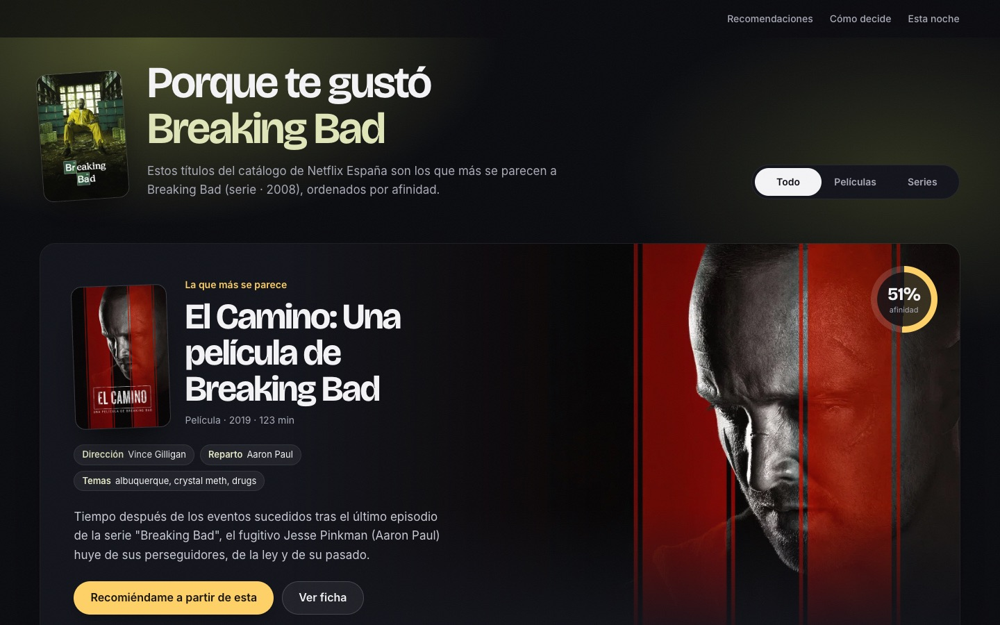
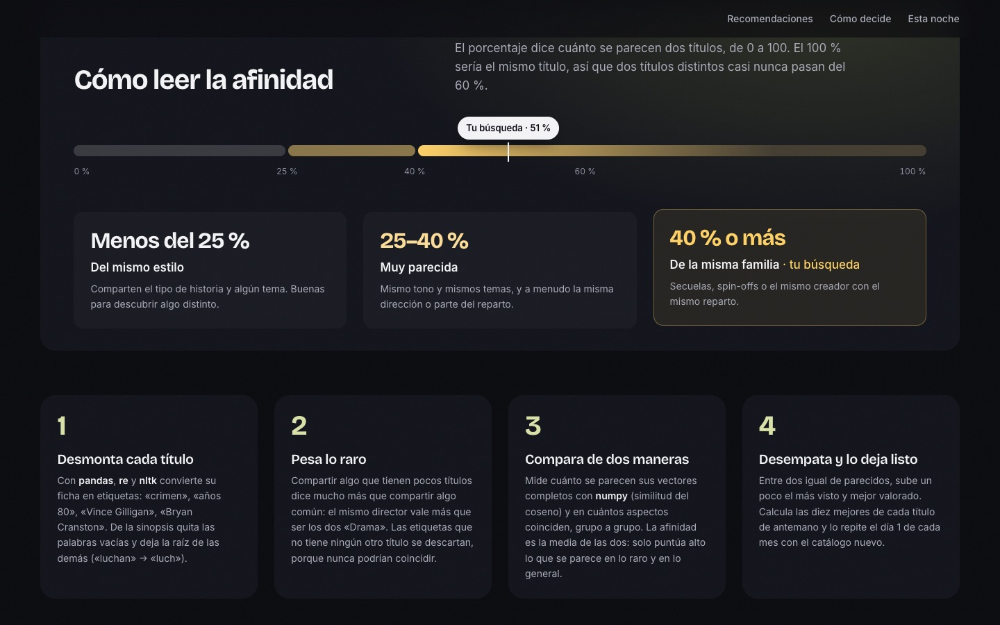
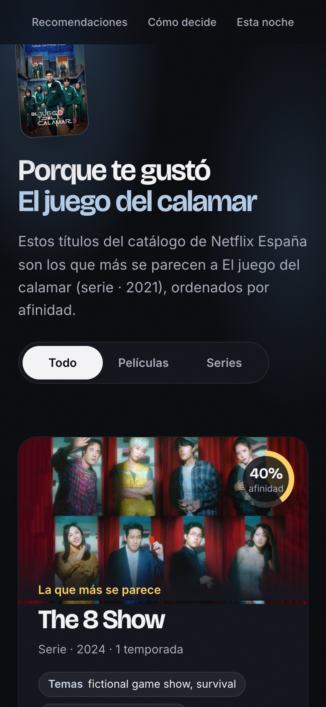
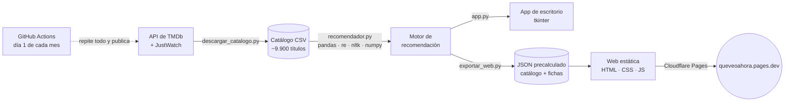

# 🍿 ¿Qué veo ahora? · Recomendador de Netflix con Python

**Dime una película o serie que te encantó y te digo qué ver esta noche en Netflix España, y por qué.**

[](https://queveoahora.pages.dev)


👉 **Pruébala en https://queveoahora.pages.dev**


Proyecto de portfolio del módulo de Python avanzado del **Máster Full Stack de Conquer Blocks**.

---

## 🎯 Qué problema resuelve

Todos hemos pasado veinte minutos bajando por Netflix sin decidirnos por nada. Esta app parte
de algo que ya sabes (una película o serie que te gustó) y busca en **el catálogo real y actual
de Netflix España** (unos 9.900 títulos) los que más se le parecen.

Cada recomendación lleva:

- un **porcentaje de afinidad** con una escala que explica qué significa;
- los **motivos concretos**: mismo director, actores en común, temas o géneros compartidos;
- su ficha con sinopsis, reparto y nota.

No usa valoraciones de otros usuarios ni ninguna caja negra: es un **recomendador basado en
contenido** escrito desde cero con `pandas`, `numpy`, `re` y `nltk`, y la web enseña en directo
cómo ha decidido.

## ✨ Qué puedes hacer en la web

| | |
|---|---|
|  | **Recomendaciones explicadas.** La más parecida en grande y diez más con su afinidad y sus motivos. Se pueden filtrar por películas o series, y cada resultado sirve como nueva búsqueda. La luz ambiente de la página toma el color del cartel que eliges. |
|  | **Cómo decide.** Ilumina los grupos (géneros, temas, dirección, reparto…) en los que coinciden de verdad tu título y la primera recomendación, y sitúa tu búsqueda en un medidor que explica cómo leer el porcentaje. |

- 🔎 **Buscador tolerante**: no importan mayúsculas ni acentos, y entiende el título original o
  el inglés («Money Heist» encuentra «La casa de papel»).
- 🌙 **«Esta noche»**: mueves una barra con el tiempo libre que tienes y te dice cuántas películas
  del catálogo te da tiempo a ver, con las cinco más populares en abanico.
- 🔗 **Enlaces para compartir**: `https://queveoahora.pages.dev/?t=Breaking Bad` abre directamente
  las recomendaciones de ese título.
- 📱 **Pensada también para el móvil**, accesible con teclado y respetuosa con quien prefiere
  menos animaciones.

<p align="center">
  
  &nbsp;&nbsp;
  
</p>

## 🏗️ Cómo está construida



### ⚙️ Backend: el motor en Python

**1. Datos reales y actuales.** Los datasets de Netflix de Kaggle se quedaron en 2021, así que
`descargar_catalogo.py` genera su propio catálogo con la API de TMDb, que sabe qué hay en
Netflix en cada país gracias a JustWatch. De cada título descarga sinopsis, géneros, palabras
clave, país, reparto, dirección (o creadores, en las series), clasificación por edades y nota.
Usa varias peticiones en paralelo (`concurrent.futures`) y reintentos. Si falta la sinopsis en
castellano usa la inglesa, y los títulos en otros alfabetos (오징어 게임) se cambian por su
título en inglés.

**2. Limpieza.** Con `pandas` y `re`, cada título se convierte en grupos de etiquetas. Con
`nltk`, las sinopsis pierden las palabras vacías y cada palabra se reduce a su raíz
(`luchan` → `luch`). El idioma de cada sinopsis se detecta solo.

**3. Rareza de cada etiqueta (TF-IDF).** Compartir algo raro informa más que compartir algo
común: el mismo director pesa mucho más que ser ambos «Drama». Las etiquetas que solo tiene un
título se descartan, porque nunca pueden coincidir y solo rebajarían todas sus afinidades.

**4. Pesos por grupo.** Cada etiqueta vale *peso de su grupo × rareza*:

| Grupo | Peso | | Grupo | Peso |
|---|---|---|---|---|
| Géneros | 3 | | Palabras de la sinopsis | 1,5 |
| Temas (palabras clave de TMDb) | 2 | | País | 1 |
| Dirección | 2 | | Clasificación por edades | 0,75 |
| Reparto (seis primeros) | 2 | | Tipo (película o serie) | 0,5 |

**5. Afinidad: dos medidas en una.** El motor calcula con `numpy`:

- el **coseno** entre los vectores completos, que premia compartir lo raro;
- la **afinidad por aspectos**: cuánto se parecen grupo a grupo (sus géneros, su reparto…),
  en media ponderada por los pesos.

La afinidad final es la **media geométrica** de las dos, así que solo puntúa alto lo que destaca
en ambas. Con el coseno solo, la mejor recomendación de un título rondaba el 15 %; ahora ronda
el 36 %, con las mismas listas (las secuelas y spin-offs siguen arriba). Para que se entienda,
la web usa esta escala:

| Afinidad | Qué significa |
|---|---|
| **40 % o más** | De la misma familia: secuelas, spin-offs, mismo creador y reparto |
| **25–40 %** | Muy parecida: mismo tono y temas, a menudo la misma dirección |
| **Menos del 25 %** | Del mismo estilo: buena para descubrir algo distinto |

**6. Rápido.** Un **índice invertido** (etiqueta → títulos que la tienen) compara un título
contra todo el catálogo en un milisegundo. Al final, entre títulos igual de parecidos se
prefieren los más populares (hasta un 15 % extra) y los mejor valorados (hasta un 3 %).

Los pesos están en el diccionario `PESOS` de `recomendador.py` y se pueden ajustar.

### 🎨 Frontend: la web

- **HTML, CSS y JavaScript puros**, sin frameworks ni dependencias.
- **Sin servidor.** Cloudflare Pages no ejecuta Python, así que `exportar_web.py` precalcula
  las recomendaciones de los ~9.900 títulos en unos 15 segundos. Las guarda en JSON (el
  catálogo más 99 bloques de fichas) y la web solo descarga el bloque que necesita.
- **Diseño de sala de cine**: pared de carteles en 3D en la portada, luz ambiente que toma el
  color del cartel elegido, medidor animado con `@property` de CSS y entradas al hacer scroll
  con `IntersectionObserver`.
- **Accesible**: navegable con teclado, textos alternativos, contraste suficiente y
  `prefers-reduced-motion` respetado.

### 🤖 Automatización: se actualiza sola

[`.github/workflows/actualizar-web.yml`](.github/workflows/actualizar-web.yml) se ejecuta el
**día 1 de cada mes**. También se lanza cuando se sube un cambio a la web o al motor, y a mano
desde la pestaña *Actions*:

1. Instala las dependencias y pasa las **pruebas** del motor.
2. Descarga el catálogo actual de Netflix España.
3. **Comprueba que está completo**: si TMDb falla a medias, no publica nada.
4. Precalcula todas las recomendaciones.
5. Publica en **Cloudflare Pages** con Wrangler.
6. Anota la fecha en [`ULTIMA_ACTUALIZACION.md`](ULTIMA_ACTUALIZACION.md) con un pequeño commit.

Las claves (TMDb y Cloudflare) se guardan como **secretos de GitHub** y nunca se suben al código.

## 🧰 Tecnologías

| Herramienta | Para qué se usa |
|---|---|
| `pandas` | Leer el catálogo y limpiar los datos |
| `numpy` | Calcular las afinidades de todo el catálogo a la vez |
| `re` | Limpiar texto y separar listas (`"Dramas, Comedies"` → `["dramas", "comedies"]`) |
| `nltk` | Quitar palabras vacías y reducir palabras a su raíz |
| `tkinter` | App de escritorio: buscador con sugerencias, tabla de resultados y ficha |
| `urllib`, `json`, `concurrent.futures` | Descargar el catálogo de TMDb en paralelo |
| `unittest` | Pruebas del motor y del descargador, sin red ni claves |
| HTML, CSS, JavaScript | La web, sin frameworks |
| GitHub Actions + Cloudflare Pages | Actualización mensual y publicación automática |

## 🚀 Ejecutarlo en local

Hace falta **Python 3.10 o superior con Tk 8.6+**. En macOS, el Python del sistema (3.9 con
Tk 8.5) deja la ventana colgada, así que conviene instalar uno nuevo:

```bash
brew install python@3.13 python-tk@3.13
```

```bash
git clone https://github.com/M4rKitS/recomendador-netflix.git
cd recomendador-netflix
python3.13 -m venv .venv
source .venv/bin/activate
pip install -r requirements.txt
python -m nltk.downloader stopwords
```

**Clave de TMDb (gratis):** crea una cuenta en [themoviedb.org](https://www.themoviedb.org/signup),
pide una clave en [Ajustes → API](https://www.themoviedb.org/settings/api), copia `.env.example`
como `.env` y pégala en `TMDB_API_KEY`. El `.env` nunca se sube a GitHub.

```bash
python descargar_catalogo.py      # descarga el catálogo (unos minutos); --pais MX para otro país
python app.py                     # app de escritorio
python recomendador.py "La casa de papel"   # prueba rápida en la terminal
```

Para la web:

```bash
python exportar_web.py                          # precalcula las recomendaciones en web/datos/
python -m http.server 8000 --directory web      # y abre http://localhost:8000
```

> Sin clave de TMDb la app también acepta los CSV antiguos de Kaggle
> ([Netflix Movies and TV Shows 2021](https://www.kaggle.com/datasets/satpreetmakhija/netflix-movies-and-tv-shows-2021)),
> porque reconoce sus nombres de columna.

## 🧪 Pruebas

```bash
python -m unittest discover -s tests -t .
```

21 pruebas que no necesitan red ni clave. Usan CSV pequeños con títulos inventados (uno con el
formato de Kaggle y otro con el de TMDb) y un cliente de TMDb falso para el descargador.

## 📁 Estructura

```
.
├── recomendador.py         # Carga de datos y motor de recomendación
├── descargar_catalogo.py   # Descarga el catálogo actual de Netflix desde TMDb
├── exportar_web.py         # Precalcula las recomendaciones en JSON para la web
├── app.py                  # App de escritorio con tkinter
├── web/                    # La web pública (index.html, estilo.css, app.js, favicon.svg)
├── tests/                  # Pruebas unitarias y CSV de ejemplo
├── docs/                   # Capturas de este README
├── .github/workflows/      # Actualización y publicación automática
├── .env.example            # Plantilla para la clave de TMDb
└── requirements.txt
```

## 🙌 Créditos

- Datos e imágenes de [TMDb](https://www.themoviedb.org/). Disponibilidad por país:
  [JustWatch](https://www.justwatch.com/).
- *Este producto usa la API de TMDb, pero no está avalado ni certificado por TMDb.*
- Proyecto educativo sin relación con Netflix: no está afiliado a Netflix ni avalado por Netflix.

Hecho por **Marcos** ([@M4rKitS](https://github.com/M4rKitS)) en el Máster Full Stack de Conquer Blocks.
